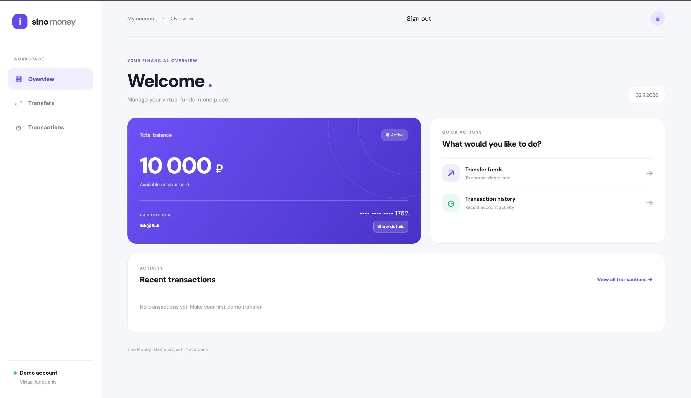
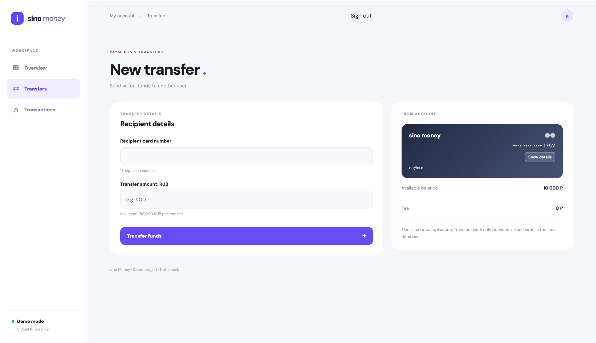
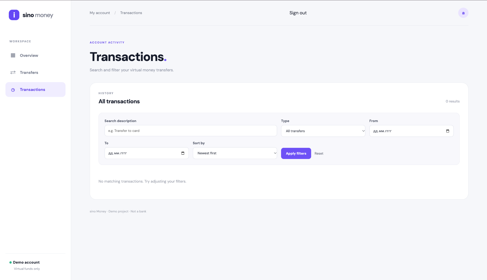

# Sino Money

**Sino Money** is a full-stack **virtual banking simulator** built with PHP and MySQL. It demonstrates account registration, virtual card management, internal transfers, and transaction history. The project focuses on implementing a working financial web application—not redesigning an existing product.

> **Educational demo only.** All balances and card numbers are fictional. Sino Money is not a bank, payment processor, or real-money service. Do not use it with real cardholder information.

## Features

- Account registration and sign-in using password hashes and PHP sessions
- A virtual card and starting balance of **10,000 demo RUB** for each newly registered user
- Card number reveal/copy controls and an interactive flashlight effect
- Transfers between demo cards, with balance validation and MySQL transactions
- Transaction history with search, incoming/outgoing filters, date range, sorting, and pagination
- CSRF protection on forms and a session-bound nonce to reduce accidental duplicate transfers
- English-language interface

## Tech stack

**Backend:** PHP 8+ (uses `str_starts_with`, `match`, and `mysqli`), MySQL 8+  
**Frontend:** HTML, CSS, vanilla JavaScript  
**Database access:** MySQLi prepared statements

## Getting started

Requirements: PHP 8+ with **mysqli** and **mbstring** enabled; MySQL 8+.

### Option A: new installation

1. Create an empty database:

   ```sql
   CREATE DATABASE bank CHARACTER SET utf8mb4;
   ```

2. Import the clean schema (no user accounts or transactions are included):

   ```bash
   mysql -u root -p bank < schema.sql
   ```

   If your local MySQL `root` account has no password, omit `-p`.

3. Copy `.env.example` to `.env` and configure your **local** database credentials. The sample defaults are for local development only. Prefer a dedicated MySQL user with limited privileges over `root`.

   ```bash
   cp .env.example .env
   ```

4. Start the PHP development server from the project directory:

   ```bash
   php -S localhost:8000
   ```

5. Open `http://localhost:8000/register.php` and create two demo accounts to test transfers. Use separate browser profiles (or a regular and an incognito window) to stay signed into both accounts simultaneously.

### Option B: existing pre-authentication database

**Back up your database first.** If your database already contains the original `cards` and `transactions` tables but not the `users` table, run `migration_001_auth.sql` **once**. Do not import `schema.sql` over existing data.

```bash
mysqldump -u root --single-transaction --set-gtid-purged=OFF bank > bank_backup.sql
mysql -u root bank < migration_001_auth.sql
```

If authentication was already installed in v0.6, **no SQL migration is needed** for this release.

## Project structure

```text
sinomoney/
├── index.php                 # Account overview
├── register.php              # Sign-up
├── login.php                 # Sign-in
├── logout.php                # Sign-out
├── auth.php                  # Session and CSRF helpers
├── transfer.php              # Virtual transfers
├── history.php               # Searchable transaction history
├── db.php                    # MySQL connection and configuration
├── style.css                 # Styles
├── card-ui.js                # Card interaction
├── schema.sql                # Clean schema for new installations
├── migration_001_auth.sql    # One-time migration for legacy installations
├── .env.example              # Example local configuration
└── .gitignore
```

## How it works

1. Registration stores a `password_hash()` result in `users` and creates a linked demo card in `cards`.
2. Login verifies the password and establishes a PHP session.
3. Authenticated pages identify the user through the session, then retrieve that user's card.
4. Transfers validate the recipient and amount, lock relevant database rows, update balances, and record debit/credit history within a MySQL transaction.
5. Transaction history queries only the signed-in user's card and applies filters on the server.

## Screenshots

### Dashboard


### Card Details


### Transfers


### Transaction History



## Security and limitations

This is a **portfolio prototype**, not production banking software. It includes password hashing, prepared statements, CSRF tokens, session-based access checks, and database transactions. These do **not** constitute a security audit.

Known limitations:

- No email verification, password reset, or sign-in rate limiting.
- The transfer form nonce is **not** durable, database-backed payment idempotency.
- The original schema still includes an unused legacy `pin` column for compatibility. No real PINs should be stored.
- Before any public deployment, review concurrency/deadlocks, least-privilege DB access, HTTPS, secure cookie settings, monitoring, and the security of the web-server document root.
- The PHP built-in server is intended for **local development**, not production hosting.

## Development process

Sino Money was developed iteratively, with **AI-assisted coding, debugging, and documentation**. The project was tested and refined through local development. AI assistance is acknowledged as part of the workflow; the repository should not be interpreted as entirely hand-written code.

## License

No open-source license has been selected yet. All rights remain with their respective owners. Add a license only after choosing its terms and checking any third-party code or assets.
